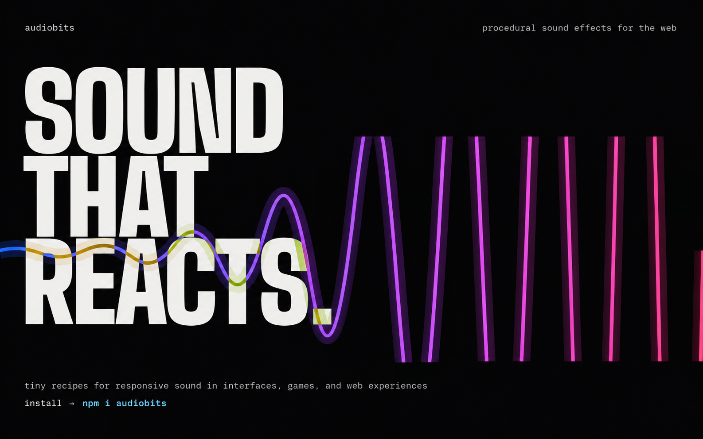

<p align="center">
  
</p>

<p align="center">
  <a href="https://www.npmjs.com/package/audiobits"></a>
  <a href="https://github.com/joacod/audiobits/actions/workflows/ci.yml"></a>
  <a href="LICENSE"></a>
</p>

**AudioBits** is a tiny, browser-native procedural audio library. Generate sound
effects from editable recipes, copy catalog sounds, and connect sound parameters
to application state. No required audio files or runtime dependencies.

[Live catalog](https://www.audiobits.dev/catalog) ·
[Documentation](https://www.audiobits.dev/docs) ·
[MCP server](https://www.audiobits.dev/docs/mcp) ·
[npm](https://www.npmjs.com/package/audiobits) ·
[Copy-paste examples](https://github.com/joacod/audiobits/tree/main/catalog)

## Quick start

Install in a browser application with a bundler:

```sh
npm install audiobits
```

Define a sound inline and play it from a user gesture:

```ts
import { createAudio, defineSound } from "audiobits";

const recipe = defineSound({
  schemaVersion: 1,
  kind: "one-shot",
  duration: 0.15,
  layers: [
    {
      id: "tone",
      source: { type: "oscillator", waveform: "sine", frequency: 660 },
      gainDb: -18,
      envelope: { attack: 0.004, decay: 0.08, sustain: 0.1, release: 0.04 },
    },
  ],
});
const audio = createAudio();
const sound = audio.sound(recipe);

export async function play() {
  await audio.start();
  sound.play();
}
export function stop() {
  audio.stopAll({ tails: "cut" });
}
export async function dispose() {
  await audio.dispose();
}
```

Or copy a ready-made sound from [catalog/](catalog/).

Construction is silent. Bind `play()` directly to a user gesture, such as a
button click, and surface activation failures with `void play().catch(console.error)`.
Retry from a fresh gesture. Bind `stop()` to Stop to cut voice tails, and await
`dispose()` when the host is removed. See the
[lifecycle guide](https://www.audiobits.dev/docs/lifecycle) for pending activation,
page hiding, and navigation.

## Explore AudioBits

### Recipes you own

Copy or install ready-to-use recipes from the [source registry](catalog/README.md),
import their local files, preview them in the
[live catalog](https://www.audiobits.dev/catalog), and adjust supported
[parameters and seeds](https://www.audiobits.dev/docs/parameters). Use them as
starting points for your own sounds. See the
[recipe guide](https://www.audiobits.dev/docs/recipes) for editable, versioned
recipe data.

### Interactive examples

[Energy Charge](https://www.audiobits.dev/catalog/energy-charge),
[Reactive Thruster](https://www.audiobits.dev/catalog/reactive-thruster), and
[Lightsaber](https://www.audiobits.dev/catalog/lightsaber) demonstrate sound driven
by application state and events. Install their reusable sound controllers through
the [source registry](catalog/README.md) and connect your existing controls.
The showcases' visuals and input adapters remain separate.

The npm package owns the engine and recipe language. Recipes and interactive
examples are copy-owned application source. Agent instructions live separately
in the [AudioBits Skill](skills/audiobits/SKILL.md).

## Why AudioBits?

- **Procedural by design.** Generate effects in the browser without managing
  prerecorded audio assets.
- **Responsive to state.** Update supported live parameters as an interaction
  changes.
- **Portable recipes.** Edit and share versioned JSON sound definitions.
- **Small runtime.** Framework-independent, with zero runtime dependencies.

## Learn more

- [Documentation](https://www.audiobits.dev/docs) and
  [live catalog](https://www.audiobits.dev/catalog).
- Contribute: [development and checks](docs/development.md),
  [architecture](docs/architecture.md), and [recipe invariants](docs/recipe-model.md).
- [Browser verification and evidence limits](docs/validation.md#browser-policy).

[MIT license](LICENSE), with [0BSD catalog source](catalog/README.md).
